 
 

<h1>Awesome Presentation Software &amp; Slide Show Engine 🚀📊</h1>

  <strong>Curated, Production-Ready Landscape of Next-Gen Presentation Platforms, Cloud Slide Suites, AI Presentation Tools &amp; Open-Source Slides-as-Code Engines</strong>

  <em>Empowering developers, conference speakers, educators, startup founders, academics, and designers to build beautiful, version-controlled, and highly engaging slide decks.</em>

---

## 📑 Table of Contents
- [🌐 Sector Overview & Market Dynamics](#-sector-overview--market-dynamics)
- [🏢 SaaS & Hosted Platforms](#-saas--hosted-platforms)
- [💻 Open-Source Slide Show Engines & Frameworks](#-open-source-slide-show-engines--frameworks)
- [🛠️ Developer Tools & Slide Automation Libraries](#-developer-tools--slide-automation-libraries)
- [📈 Star History](#-star-history)
- [🤝 How to Contribute](#-how-to-contribute)
- [💖 Support](#-support)
- [⚠️ Disclaimer](#-disclaimer)

---

## 🌐 Sector Overview & Market Dynamics

The global presentation software market was valued at approximately **$9.5 billion in 2025** and is projected to expand to over **$18.2 billion by 2032**, registering a compound annual growth rate (CAGR) of around **9.8%**, propelled by enterprise demand for real-time collaboration, generative AI slide generation, and interactive data visualization.

The industry exhibits a **moderately fragmented and bifurcated structure**: while legacy mega-suites (Microsoft 365 / PowerPoint and Google Workspace / Slides) maintain a dominant enterprise market share of over 70%, the emergence of AI-native slide engines (such as Gamma and Beautiful.ai), visual design-first ecosystems (Canva), and developer-oriented "Slides-as-Code" frameworks (such as Reveal.js, Slidev, and Typst) prevents a winner-take-all monopoly and continues to unlock high-growth niche markets.

---

## 🏢 SaaS & Hosted Platforms

A comprehensive comparison of top commercial and hosted presentation platforms, ranked in descending order by parent company scale (market capitalization / enterprise valuation).

| 🏷️ Platform | 💡 Key Highlights & Features | 💰 Pricing (Starting Tier) | 🎁 Free Tier / Free Trial Limits | 🏛️ Company Scale (Valuation / Market Cap) |
| :--- | :--- | :--- | :--- | :--- |
| **[Microsoft PowerPoint for the Web](https://microsoft.com)** | Cloud edition of the industry-standard presentation suite featuring Designer AI layouts, Speaker Coach, and Microsoft 365 co-authoring. | **$6.00/user/month** (Microsoft 365 Business Basic annual) | **Free forever plan** with basic web editing via free Microsoft account (5 GB OneDrive cloud storage limit). | **~$3,100 Billion** (Market Cap) |
| **[Google Slides](https://google.com)** | Ubiquitous cloud-native presentation editor offering seamless multi-user collaboration, Q&A audience tools, and Google Workspace integration. | **$7.00/user/month** (Google Workspace Business Starter) | **Free forever plan** with unlimited presentation creation using free Google account (15 GB shared Google Drive storage limit). | **~$2,100 Billion** (Market Cap) |
| **[Canva Presentations](https://canva.com)** | Web-based visual design and presentation studio featuring Magic Design AI, vast asset libraries, presenter view, and real-time collaboration. | **$15.00/month** (or $120/year Canva Pro single user) | **Free forever plan** with 1M+ free templates/photos, 1000+ fonts, and 5 GB cloud asset storage. | **~$26 Billion** (Valuation) |
| **[Zoho Show](https://zoho.com)** | Collaborative online presentation software offering clean animations, contextual commenting, custom themes, and PowerPoint compatibility. | **$3.00/user/month** (Zoho Workplace Standard plan) | **Free forever plan** with up to 5 users, 5 GB shared storage limit, and full presentation creation tools. | **~$15 Billion** (Valuation / Enterprise Est.) |
| **[Prezi](https://prezi.com)** | Cloud-based non-linear presentation platform famed for its zoomable spatial canvas and dynamic visual storytelling transitions. | **$7.00/month** (Prezi Standard annual billing) | **14-day free trial** of paid tiers; or limited free Basic plan allowing up to 5 public presentations only. | **~$700 Million** (Valuation Est.) |
| **[Visme](https://visme.co)** | All-in-one cloud visual communication platform specializing in data-rich presentations, interactive charts, infographics, and brand kits. | **$12.25/month** (Starter annual billing, $29/mo monthly) | **Free forever plan** with 100 MB storage limit, limited template access, and Visme-branded watermark on public exports. | **~$350 Million** (Valuation Est.) |
| **[Pitch](https://pitch.com)** | Modern collaborative presentation software built for fast-moving teams, offering real-time co-editing, smart formatting, analytics, and sleek templates. | **$20.00/editor/month** (Pro plan monthly, or $17/editor/mo annual) | **Free forever plan** with unlimited presentations, unlimited members, and 500 AI credits total limit. | **~$250 Million** (Valuation) |
| **[Beautiful.ai](https://beautiful.ai)** | AI-assisted cloud presentation platform featuring Smart Slides that automatically adapt layout, spacing, and typography as content changes. | **$12.00/month** (Pro individual annual billing, $144 billed upfront) | **14-day free trial** with full Pro feature access (credit card required to activate). | **~$150 Million** (Valuation Est.) |
| **[Gamma App](https://gamma.app)** | AI-native presentation, document, and webpage generator transforming prompts and notes into interactive, card-based slide decks in seconds. | **$10.00/user/month** (Plus plan monthly, or $8/user/mo annual) | **Free forever plan** with 400 one-time AI generation credits upon sign-up and "Made with Gamma" watermark. | **~$100 Million** (Valuation Est.) |
| **[Slidebean](https://slidebean.com)** | Cloud pitch-deck design platform tailored for startup founders, combining automated layout structuring with investor analytics. | **$149.00/year** (All Access Plan, ~$12/month equivalent) | **Free forever plan** with basic deck editor, unlimited non-exportable presentations, and standard design templates. | **~$30 Million** (Valuation Est.) |

---

## 💻 Open-Source Slide Show Engines & Frameworks

A curated catalog of the finest open-source presentation software, slide compilers, and terminal engines, sorted in descending order by GitHub stargazer count.

| 📦 Repository & Name | ⭐ GitHub Stargazers | 📝 Description | 🚀 Technology Stack |
| :--- | :--- | :--- | :--- |
| **[Excalidraw](https://github.com/excalidraw/excalidraw)** |  | Virtual collaborative whiteboard and infinite canvas presentation tool for hand-drawn architectural walkthroughs. | TypeScript, React, Canvas API |
| **[Reveal.js](https://github.com/hakimel/reveal.js)** |  | The premier open-source HTML presentation framework supporting nested 2D slides, Markdown, syntax highlighting, and speaker notes. | JavaScript, HTML5, CSS3 |
| **[Slidev](https://github.com/slidevjs/slidev)** |  | Presentation slides for developers powered by Markdown, Vue 3, Vite, UnoCSS, and live interactive coding components. | TypeScript, Vue 3, Vite |
| **[Pandoc](https://github.com/jgm/pandoc)** |  | The universal markup converter capable of compiling Markdown documents into Reveal.js, Slidy, Beamer, and PowerPoint `.pptx` decks. | Haskell |
| **[Impress.js](https://github.com/impress/impress.js)** |  | Presentation framework based on the power of CSS3 3D transforms and transitions in modern browsers, inspired by Prezi. | JavaScript, CSS3 3D |
| **[Remark.js](https://github.com/gnab/remark)** |  | Simple, in-browser Markdown-driven slideshow engine targeted at speakers who want zero-build-step HTML slides. | JavaScript, Markdown |
| **[Slides](https://github.com/maaslalani/slides)** |  | Minimalist terminal-based presentation tool built in Go that renders Markdown files directly inside CLI windows. | Go, Bubble Tea, Lip Gloss |
| **[MDX Deck](https://github.com/jxnblk/mdx-deck)** |  | React and MDX-based presentation decks combining Markdown ergonomics with live interactive React UI widgets. | JavaScript, React, MDX |
| **[Spectacle](https://github.com/FormidableLabs/spectacle)** |  | A React.js-based presentation library allowing software engineers to build rich, custom interactive JSX slide decks. | TypeScript, React |
| **[Presenterm](https://github.com/mfontanini/presenterm)** |  | Terminal slideshow tool written in Rust supporting Markdown, live code execution, Kitty/Sixel graphics, and export. | Rust, Ratatui |
| **[OnlyOffice Document Server](https://github.com/ONLYOFFICE/DocumentServer)** |  | Open-source enterprise collaborative online office suite offering high-fidelity PPTX presentation co-editing. | C++, C#, JavaScript |
| **[PptxGenJS](https://github.com/gitbrent/PptxGenJS)** |  | JavaScript library for programmatically generating rich PowerPoint `.pptx` presentations on both client browsers and Node.js. | TypeScript, JavaScript |
| **[Quarto CLI](https://github.com/quarto-dev/quarto-cli)** |  | Open-source scientific publishing system compiling computational Markdown/Jupyter to Reveal.js, Beamer, and PPTX. | TypeScript, Deno, Pandoc |
| **[Fusuma](https://github.com/hiroppy/fusuma)** |  | Modern slide deck generator from Markdown files with WebGL shaders, live code running, and recording abilities. | JavaScript, React, Webpack |
| **[Bespoke.js](https://github.com/bespokejs/bespoke)** |  | Ultra-lightweight modular presentation micro-framework (&lt;1 KB) designed for bespoke slide transitions and extensions. | JavaScript |
| **[Cleaver](https://github.com/jdan/cleaver)** |  | 30-second Slideshows for Hackers — instant compilation of clean Markdown documents into themed HTML slides. | JavaScript, Node.js |
| **[Marp CLI](https://github.com/marp-team/marp-cli)** |  | CLI interface for Marp and Marpit slide ecosystems, converting Markdown to HTML, PDF, PPTX, and image slide sequences. | TypeScript, Node.js |
| **[python-pptx](https://github.com/scanny/python-pptx)** |  | Python library for creating and updating Microsoft PowerPoint `.pptx` presentation files via automated backend scripts. | Python, OpenXML |
| **[Collabora Online](https://github.com/CollaboraOnline/online)** |  | Collaborative web-based version of LibreOffice Impress for secure on-premise editing of presentation files. | C++, JavaScript |
| **[Patat](https://github.com/jaspervdj/patat)** |  | Presentations Atop The ANSI Terminal — terminal presentation engine featuring syntax highlighting and multi-format parser. | Haskell |
| **[Touying (Typst)](https://github.com/touying-typ/touying)** |  | Modern, powerful presentation slide package built on top of the next-generation Typst typesetting ecosystem. | Typst |
| **[Decktape](https://github.com/astefanutti/decktape)** |  | High-quality automated PDF exporter for HTML5 presentation frameworks including Reveal.js, Slidev, Impress, and Remark. | JavaScript, Puppeteer |
| **[Lookatme](https://github.com/d0c-s4vage/lookatme)** |  | Interactive, terminal-based Markdown presentation tool with live terminal shell execution and extension plugins. | Python, Urwid |
| **[LaTeX Beamer](https://github.com/josephwright/beamer)** |  | The definitive academic standard LaTeX document class for preparing mathematical and scientific conference slides. | TeX, LaTeX |
| **[Sozi](https://github.com/senshu/Sozi)** |  | Zooming presentation editor using SVG vector graphics created in Inkscape as infinite-canvas presentation slides. | TypeScript, Electron, SVG |
| **[Polylux (Typst)](https://github.com/andreasKroepelin/polylux)** |  | Clean presentation package for Typst enabling progressive slide disclosure, themes, and subslides. | Typst |
| **[Marp Core](https://github.com/marp-team/marp-core)** |  | Core converter component of Marpit that extends markdown-it with customizable directives, CSS themes, and pagination. | TypeScript, JavaScript |
| **[Slippy](https://github.com/Seldaek/slippy)** |  | Lightweight HTML presentation system built on jQuery with keyboard navigation and responsive styling. | JavaScript, HTML5 |

---

## 🛠️ Developer Tools & Slide Automation Libraries

- 🤖 **Programmatic Generation**: Use [`python-pptx`](https://github.com/scanny/python-pptx) or [`PptxGenJS`](https://github.com/gitbrent/PptxGenJS) to inject database records and analytical charts directly into native `.pptx` decks.
- 📄 **Headless PDF Export**: Leverage [`Decktape`](https://github.com/astefanutti/decktape) to automate PDF rendering and archiving of web slide frameworks in CI/CD pipelines.
- ⚡ **Rapid Markdown Prototyping**: Combine VS Code with the [Marp extension](https://marketplace.visualstudio.com/items?itemName=marp-team.marp-vscode) for instant side-by-side slide editing and export.
- 📐 **Scientific & Mathematical Publishing**: Choose [Quarto](https://quarto.org) or [Typst + Touying](https://github.com/touying-typ/touying) for papers, formulas, citations, and reproducible research slides.

---

## 📈 Star History

---

## 🤝 How to Contribute

Contributions are warmly welcome! Help expand and maintain this developer guide:

1. 🍴 **Fork** this repository.
2. 🌿 **Create a new branch** (`git checkout -b feature/add-new-presentation-engine`).
3. 📝 **Add your entry** under the appropriate section following table formatting conventions. Include official URLs, pricing/Stars_Badges, and factual summaries.
4. 🚀 **Commit your changes** (`git commit -m "Add New Presentation Engine"`).
5. 📤 **Push to your branch** (`git push origin feature/add-new-presentation-engine`).
6. 🎯 **Open a Pull Request** describing your additions.

---

## 💖 Support

If you find this ecosystem guide helpful for your projects, conferences, or presentations, please consider supporting the project:

- ⭐ **Star this repository** on GitHub to help others discover it!
- 🍴 **Fork and share** with colleagues, developer communities, and conference speakers.
- ☕ **Sponsor or buy a coffee**: Support ongoing curation and open-source contributions directly on the [**GitHub Sponsor Dashboard**](https://github.com/sponsors/ishandutta2007).

---

## ⚠️ Disclaimer

- This repository is a **community-curated collection** created for informational, educational, and developer convenience. Listing does not imply an endorsement or affiliation.
- All product names, logos, brands, and trademarks belong to their respective owners.
- When delivering presentations at live venues with web-based HTML5 slides (e.g. Reveal.js, Slidev), always pre-bundle local web assets and fonts, or carry an exported backup PDF file to protect against unstable conference Wi-Fi networks.

---

  Built with ❤️ for developers, speakers, academics, and presentation hackers worldwide.

